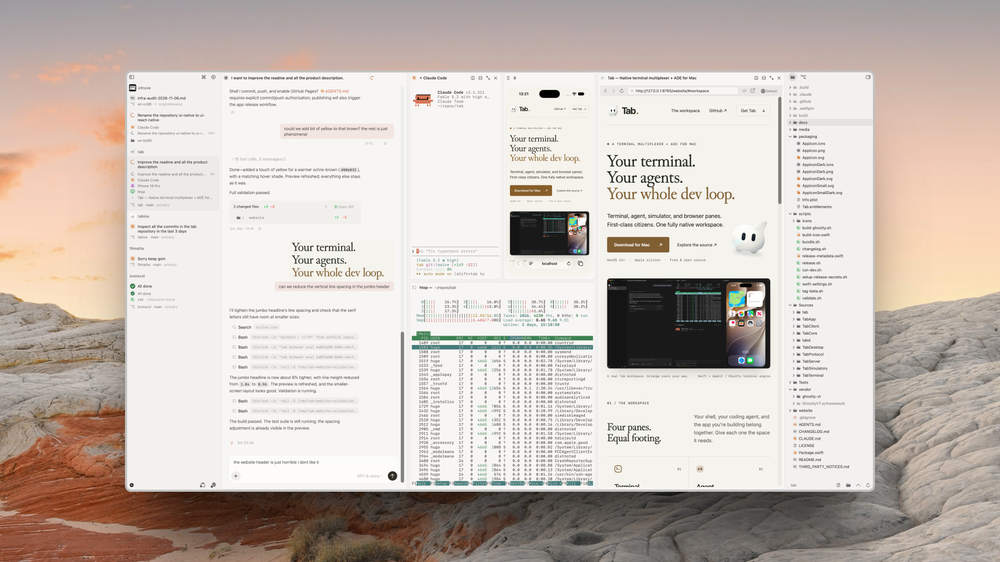

<p align="center">
  
</p>

<h1 align="center">Tab</h1>

<p align="center"><strong>A fully native terminal multiplexer + agent development environment for Mac.</strong></p>

<p align="center">
  <a href="https://github.com/hugocxl/tab/releases/latest">Download for Mac</a> ·
  <a href="https://hugocxl.github.io/tab/">Website</a> ·
  <a href="CHANGELOG.md">Changelog</a> ·
  <a href="#build-from-source">Build from source</a>
</p>

## Your terminal. Your agents. Your whole dev loop.

**Terminal, agent, simulator, and browser panes.** First-class citizens. One fully native workspace.

Tab combines a terminal multiplexer with an **agent development environment (ADE)**: a workspace for coding agents and the tools you use to run, inspect, and test their changes. Written in Swift and AppKit, with its own background server included.

**macOS 14+ · Apple silicon · Free & open source**

<a href="media/tab-window.png"></a>

*Four panes. One workspace. Arrange yours your way.*

## Four panes. Equal footing.

Your shell, your coding agent, and the app you're building belong together. Give each one the space it needs.

| Pane | What you can do |
| --- | --- |
| **Terminal** | Run commands, watch logs, and keep development servers going with the Ghostty terminal engine. Split, resize, and arrange your sessions. |
| **Agent** | Work with Claude Code or Codex in a native conversation pane. Keep the tools to inspect and test their changes right beside them. |
| **Simulator** | See your mobile app where you're working. Interact with iOS simulators and Android emulators in their own panes. |
| **Browser** | Open your local app, a preview, or the docs. Keep the page in view while you change the code that powers it. |

## Fully native. Right down to the feel.

Written in **Swift**. Built with **AppKit**. Native keyboard shortcuts, flexible split panes, and macOS glass surfaces. A workspace made for the Mac you're using, with the vendored Ghostty terminal engine and no Electron runtime.

## One project. As many angles as you need.

- **A tab for the task.** Give each project or Git worktree its own sidebar tab. Arrange panes inside it. Keep parallel tasks separate, with files and Git diffs close at hand.
- **Your agents. Your way of working.** Use your installed and authenticated Claude Code or Codex CLI in native agent panes. Prefer another CLI agent? Run it in a terminal pane.
- **Local feel. Remote Mac.** Connect to another Mac over SSH. Work with its projects, terminals, and simulators. Browser pages travel through the server's tunnels, so `localhost` stays with the workspace.

## Close the app. Keep your terminals running.

Tab's own background server, **`tabd`**, owns your terminal sessions and workspace state. Quit the desktop app, come back later, and reconnect to your work.

The Mac running your workspace needs to stay awake. Closing a terminal pane ends that session.

The native desktop app, `tab` command-line tool, and `tabd` server ship together in one Mac app bundle.

## Get Tab

1. [Download the latest DMG](https://github.com/hugocxl/tab/releases/latest) for macOS 14+ on Apple silicon.
2. Drag Tab into Applications.
3. Open a project. Make it yours.

Native agent conversations use an installed, authenticated Claude Code or Codex CLI on the Mac running your workspace. Tab is free and open source; agent-provider accounts and fees are separate. iOS simulators need Xcode and a simulator runtime; Android emulators need the Android SDK and an emulator.

## Build from source

You'll need Xcode's Swift 6 toolchain and Zig 0.17 to build the vendored terminal framework. Build GhosttyVT once, then validate the app:

```sh
scripts/build-ghostty.sh
scripts/validate.sh
```

Validation builds with warnings as errors, runs the tests, and creates `build/debug/Tab Dev.app`. For a faster iteration, use `swift build`. To bundle and launch the development app with this checkout's profile:

```sh
scripts/run-dev.sh
```

See [AGENTS.md](AGENTS.md) for architecture and contribution rules, [`scripts/release.sh`](scripts/release.sh) for release packaging, and [`website/README.md`](website/README.md) for the website and GitHub Pages setup.

## License

[MIT](LICENSE) © Hugo Corta
