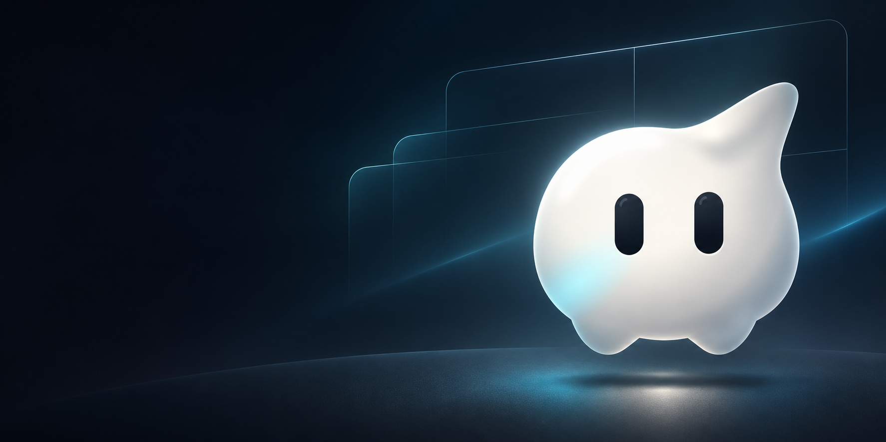

<p align="center">
  
</p>

<h1 align="center">Tab</h1>

<p align="center"><strong>A native macOS workspace for terminals, coding agents, and everything around them.</strong></p>

<p align="center">
  <a href="https://github.com/hugocxl/tab/releases/latest">Download for Mac</a> ·
  <a href="#see-tab-in-action">Screenshot</a> ·
  <a href="#build-from-source">Build from source</a> ·
  <a href="CHANGELOG.md">Changelog</a>
</p>

Tab brings your projects, terminal sessions, agent conversations, browser pages, and device simulators into one AppKit window. Arrange them as split panes, move between projects and Git worktrees from the sidebar, and pick up where you left off: the `tabd` server keeps terminal sessions running after the app closes.

Made for **macOS 14 or later on Apple silicon**. The desktop app is written in Swift and uses the vendored Ghostty terminal engine.

## See Tab in action

<a href="media/tab-window.png"></a>

*The running Tab app, with an Agent pane, two terminal panes, and an iPhone simulator. [Open the full-size screenshot](media/tab-window.png).*

## One workspace, many ways to work

- **Terminals that stay alive.** Sessions belong to the background server, so closing the desktop window does not end your work.
- **Agents beside your tools.** Talk to Claude Code or Codex in a native conversation pane using their installed CLIs, or run an agent in a terminal pane.
- **Projects and worktrees.** Keep each project or worktree in its own sidebar tab, with the panes you need arranged together.
- **More than terminals.** Open browser, file, Git, and device views alongside your shell and agents. Device panes can show iOS simulators and Android emulators.
- **Remote Mac workspaces.** Connect to a Tab server over SSH and work with remote terminals and projects from the same app.

## Get Tab

Download the latest macOS app from [GitHub Releases](https://github.com/hugocxl/tab/releases/latest), open the DMG, and move Tab to Applications. Tab includes the desktop app, the `tab` command-line tool, and the `tabd` server in one bundle.

Claude Code and Codex conversations use the respective provider CLI installed and authenticated on your Mac.

## Build from source

You'll need Xcode's Swift 6 toolchain and Zig 0.17 to build the vendored terminal framework. Build GhosttyVT once, then validate and bundle the app:

```sh
scripts/build-ghostty.sh
scripts/validate.sh
scripts/bundle.sh debug
```

The development app is created at `build/debug/Tab Dev.app`. For a faster iteration, run `swift build`; the full `scripts/validate.sh` gate builds with warnings as errors, runs tests, and checks the debug bundle.

For the module layout and contribution rules, see [AGENTS.md](AGENTS.md). For a local release package, see the instructions at the top of [`scripts/release.sh`](scripts/release.sh).

## License

[MIT](LICENSE) © Hugo Corta
