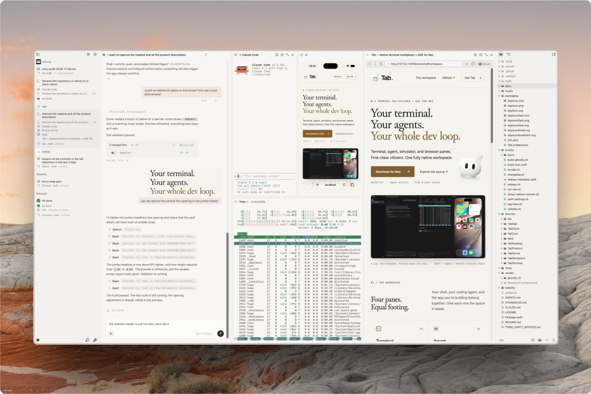

# Tab

### Your terminal. Your agents. Your whole dev loop.

**A fully native terminal multiplexer and agent development environment for the Mac.** Terminal, agent, simulator, and browser panes sit side by side in one workspace, with its own background server included. Tab for iPhone and iPad takes your Mac's tabs, terminals and agents with you.

[Download for macOS](https://github.com/hugocxl/tab/releases/latest) · [Read the docs](https://hugocxl.github.io/tab/docs.html) · [Visit the website](https://hugocxl.github.io/tab/)

[](https://hugocxl.github.io/tab/)

## Highlights

- **Four panes, equal footing.** Terminals, Claude Code / Codex agent panes, iOS/Android simulators, and local browser panes in one split layout per project or Git worktree.
- **Persistent background server.** Close the app and keep your terminals and workspaces running; connect to another Mac over SSH and its projects feel local.
- **Fully native.** Written in Swift and AppKit with native shortcuts, split panes, and macOS glass surfaces — no Electron.
- **Scriptable.** The `tab` CLI lets you and your agents open panes, read terminals, and drive browsers from any shell.
- **On your iPhone and iPad.** Pair in Settings → Mobile to reach the same tabs, live terminals and agents from anywhere, over certificate-pinned TLS.

## Development

This repository holds both apps:

| Folder | What |
| --- | --- |
| [`macos/`](macos) | The Mac app, the `tabd` server and the `tab` CLI |
| [`ios/`](ios) | Tab for iPhone and iPad |
| [`website/`](website) | The website and docs |

The Mac app requires macOS 14+ on Apple silicon, Xcode 27, Zig 0.17 (for `libghostty-vt`), and `ripgrep`. The iOS app requires the iOS 27 SDK.

```sh
macos/scripts/build-ghostty.sh       # once: build macos/vendor/GhosttyVT.xcframework
macos/scripts/run-dev.sh             # build and launch this checkout's isolated Mac dev app
macos/scripts/stop.sh                # quit this checkout's dev app and stop its tabd
ios/scripts/run-sim.sh [iphone|ipad] # build and launch the iOS app on a simulator
scripts/validate.sh [macos ios website] # validate every project, or the named ones
```

Website (self-contained in `website/`):

```sh
cd website && npm ci && npm run build:site && npm run check:site
```

Each Git worktree builds an isolated `Tab Dev (<worktree>)` Mac app and its own iOS app, so parallel worktrees never collide.

## Releases

Commits follow `<Added|Changed|Removed|Improved|Fixed>: <One user-facing sentence.>` — `.githooks/` automatically updates `CHANGELOG.md` and creates the matching `vX.Y.Z` tag. Both apps share one version. Pushing to `main` runs the Release workflow (validate, sign, notarize, publish the Mac DMG and `update.json`); `ios/scripts/release.sh` uploads the iOS app to TestFlight. One-time secret setup:

```sh
scripts/setup-release-secrets.sh /path/DeveloperID.p12 --api-key /path/AuthKey_KEYID.p8 <issuer-id> --update-key "Tab update signing key" tab-release
```

## License

Tab is [MIT licensed](LICENSE). Third-party code and artwork keep their own licenses in [THIRD_PARTY_NOTICES.md](THIRD_PARTY_NOTICES.md). Made by [Hugo](https://github.com/hugocxl).
